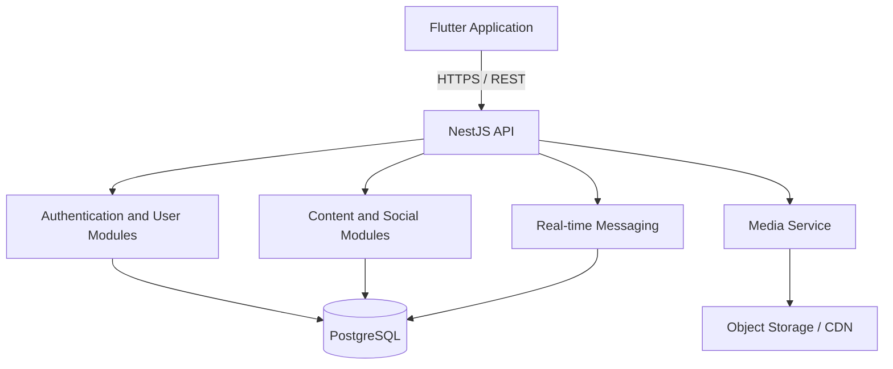

# Luma --- Create. Connect. Grow.

---

## Table of Contents

* [About Luma](https://www.google.com/search?q=%23about-luma)
* [Application Showcase](https://www.google.com/search?q=%23application-showcase)
* [Product Vision](https://www.google.com/search?q=%23product-vision)
* [Features](https://www.google.com/search?q=%23features)
* [Technology Stack](https://www.google.com/search?q=%23technology-stack)
* [System Architecture](https://www.google.com/search?q=%23system-architecture)
* [Repository Structure](https://www.google.com/search?q=%23repository-structure)
* [Getting Started](https://www.google.com/search?q=%23getting-started)
* [Backend API](https://www.google.com/search?q=%23backend-api)
* [Implementation Status](https://www.google.com/search?q=%23implementation-status)
* [Roadmap](https://www.google.com/search?q=%23roadmap)
* [Security Notes](https://www.google.com/search?q=%23security-notes)
* [Contributing](https://www.google.com/search?q=%23contributing)
* [License](https://www.google.com/search?q=%23license)

---

## About Luma

**Luma** is a social media and creator-platform project designed to bring together short-form video, longer-form content, social interaction, learning, communities, and personal development in one experience. Luma takes inspiration from familiar social platforms while building its own identity around a simple philosophy:

> *"Luma isn't only about consuming content. It's about creating, connecting, and growing."*

The project has two main parts: a Flutter frontend and a NestJS backend. Development is proceeding in stages, starting with the application experience and a backend foundation before production services are integrated.

---

## Application Showcase

### See Luma in Action

The project demonstration video is intended to show the application's interface, navigation, visual design, and user experience.

* **Showcase file path:** `luma/luma/assets/luma.mp4`

This is a visual showcase of what the system looks like when running. It demonstrates the application's current appearance and experience; it does not imply that every feature on the roadmap is already operational.

[Watch the Luma application showcase](https://www.google.com/search?q=luma/assets/luma.mp4)

*(Note: GitHub's inline video rendering depends on the file being committed and on the repository's supported media presentation. If it does not render inline, the link still lets visitors open the video.)*

---

## Product Vision

Luma brings several connected experiences into one platform:

* **Social Feed:** Share updates and discover content.
* **Stories:** Share temporary visual updates.
* **Shorts:** Browse vertical short-form videos.
* **Long-form Video:** Support deeper creator content as the platform develops.
* **Messaging:** Enable direct conversations.
* **Communities:** Connect people around shared interests.
* **Luma Journey:** Document goals, progress, and personal milestones.
* **Luma Learning:** Combine learning resources, notes, quizzes, and practice.
* **Creator Tools:** Help creators publish, grow, and eventually monetize their work.

A central product concept is **One Content → Three Experiences**: one piece of creator content could become a longer video, a short clip, and a social post or preview.

---

## Features

### Frontend Experience

The current frontend development includes:

* Authentication and registration screens.
* A local prototype verification flow.
* Home feed with sample posts.
* Stories row and story viewer.
* Short-form video feed using local video assets.
* Content creation with media selection, preview, and captions.
* Messaging interface and individual chat screens.
* Prototype messaging streaks.
* Profile editing and profile-picture selection/removal.
* Appearance preferences for System, Light, and Dark themes.
* Animated interface elements and Luma's purple/cyan visual identity.
* Local prototype stores for posts, stories, and streak data.

### Planned Platform Capabilities

* Production email or phone verification.
* Secure server-backed authentication and authorization.
* Multi-account support backed by separate user accounts and sessions.
* Persistent posts, likes, comments, follows, and social graph.
* Real-time messaging and reliable daily streak tracking.
* Media upload, processing, and delivery.
* Communities, challenges, and creator tools.
* Premium subscriptions and creator monetization.
* Live streaming, watch parties, and a creator marketplace.
* AI-assisted creation and discovery.

---

## Technology Stack

| Area | Technology | Purpose |
| --- | --- | --- |
| **Frontend** | Flutter | Cross-platform application UI |
| **Frontend Language** | Dart | Application logic |
| **Backend** | NestJS | Node.js API framework |
| **Backend Language** | TypeScript | Backend implementation |
| **Runtime** | Node.js | Backend execution |
| **Local Preferences** | `shared_preferences` | Local prototype preferences and session state |
| **Media Selection** | `file_picker` | Selecting local media |
| **Video Playback** | `video_player` | Playing video content |
| **Typography** | `google_fonts` | Application typography |
| **Database** | PostgreSQL *(Planned)* | Persistent relational database |
| **ORM** | Prisma *(Planned)* | Database access layer |

> **Note:** PostgreSQL and Prisma are part of the intended backend direction. They should not be considered integrated until database configuration, schema, and migrations are present in the backend repository.

---

## System Architecture

### Target Architecture



*This is the intended architecture, not a claim that every module or infrastructure component is already implemented.*

### Intended Request Flow

1. A user interacts with the Flutter application.
2. The frontend sends an HTTP request to the NestJS API.
3. NestJS controllers receive requests and delegate application logic to services.
4. Services validate and process the request.
5. Persistent data is stored in PostgreSQL once database integration is implemented.
6. The API returns a response for the Flutter application to display.

---

## Repository Structure

The frontend and backend are separate projects. A combined workspace can be organized as follows:

```text
luma-workspace/
├── luma/                  # Flutter frontend
│   ├── assets/
│   │   └── videos/
│   ├── lib/
│   │   ├── auth/
│   │   ├── data/
│   │   ├── screens/
│   │   ├── theme/
│   │   └── main.dart
│   ├── pubspec.yaml
│   └── ...
├── luma-backend/
│   └── luma-api/          # NestJS backend
│       ├── src/
│       ├── test/
│       ├── package.json
│       └── ...
└── README.md              # Combined project documentation

```

**Known local development paths:**

* Frontend: `/luma/luma`
* Backend: `/luma/luma-backend/luma-api`

*Adjust the tree and paths if the projects are moved or combined into a single Git repository.*

---

## Getting Started

### Prerequisites

* Git
* Flutter SDK and Dart (frontend)
* Node.js and npm (backend)
* A code editor such as Visual Studio Code
* PostgreSQL will be required when database integration is added.
* Android Studio and the Android SDK are useful for Android development.
* Building and signing an iOS release requires macOS and Xcode.

### Frontend: Flutter

1. Open a terminal and navigate to the frontend directory:
```bash
cd /luma/luma

```


2. Install dependencies:
```bash
flutter pub get

```


3. Check the environment and available devices:
```bash
flutter doctor
flutter devices

```


4. Run on a supported Linux desktop device:
```bash
flutter run -d linux

```


5. Run static analysis:
```bash
flutter analyze

```


*(Replace the example path if your project is stored elsewhere.)*

> **Frontend Assets:** Local video assets are stored in `assets/videos/`. The asset declarations in `pubspec.yaml` must match the actual files and directory structure. Check YAML indentation if Flutter cannot locate an asset.

### Backend: NestJS

1. Open a separate terminal and navigate to the backend directory:
```bash
cd /luma/luma-backend/luma-api

```


2. Install dependencies:
```bash
npm install

```


3. Start the development server:
```bash
npm run start:dev

```


4. Run the build:
```bash
npm run build

```


5. Run tests using the scripts configured in `package.json`:
```bash
npm test

```


*(Run backend commands from the `luma-api` directory, where its `package.json` is located.)*

### Running Both Applications

1. Start the NestJS backend in one terminal.
2. Start the Flutter frontend in another terminal.
3. Configure the frontend API base URL when API integration is implemented.
4. Test each application independently, then test their integration.

*(A Linux desktop app, Android emulator, and physical phone may require different API host addresses. Configure the host for the device running the Flutter application.)*

---

## Backend API

The first backend milestone is a health-check endpoint that confirms the API process is running. The intended response is:

```json
{
  "app": "Luma",
  "status": "online",
  "message": "Luma API is running 🚀"
}

```

The exact route and response must be verified in the current NestJS controller before being treated as an available API contract. The NestJS starter previously exposed `GET /`; `/api/health` is the intended Luma endpoint if it has been added. If `/api/health` is implemented, test it with:

```bash
curl http://localhost:3000/api/health

```

*(Use the port and route configured by the backend.)*

### Planned API Areas

| Area | Responsibility |
| --- | --- |
| **Authentication** | Registration, login, logout, token lifecycle |
| **Users** | Profiles, account settings, user discovery |
| **Posts** | Create, retrieve, update, and delete posts |
| **Stories** | Publish and retrieve stories |
| **Shorts and Videos** | Video metadata and discovery |
| **Social Graph** | Follow, unfollow, likes, and comments |
| **Messaging** | Conversations and message history |
| **Media** | Upload authorization and media metadata |

---

## Implementation Status

Luma is under active development. This status reflects the project development notes and should be checked against the latest source before a release.

| Component | Status |
| --- | --- |
| Flutter application foundation | **Implemented** |
| Home feed prototype | **Implemented** |
| Stories and story viewer | **Implemented** |
| Shorts video experience | **Implemented** |
| Create and media-preview flow | **Implemented** |
| Messaging and chat prototype | **Implemented** |
| Profile editing and profile image | **Implemented** |
| Theme preferences | **Added** (verify build) |
| Local prototype authentication | **Implemented** |
| Real email verification | *Planned* |
| NestJS project foundation | **Created** (verify current server state) |
| Luma health endpoint | *Verify route and response* |
| PostgreSQL integration | *Planned / not confirmed* |
| Prisma integration | *Planned / not confirmed* |
| Production authentication | *Planned* |
| Flutter-to-API integration | *Planned* |
| Production media storage | *Planned* |
| Real-time messaging infrastructure | *Planned* |

> **Prototype limitation:** Local prototype data is not equivalent to a production multi-user backend. Features based on local preferences or in-memory stores may not synchronize between devices or users.

---

## Roadmap

* **Phase 1 --- Frontend foundation**
* Establish Flutter application structure.
* Build core navigation and main screens.
* Add feed, Stories, Shorts, and content creation prototypes.
* Add messaging and profile experiences.
* Verify theme behavior across all screens.
* Expand automated and manual UI testing.


* **Phase 2 --- Backend foundation**
* Create the NestJS project.
* Confirm and document the health endpoint.
* Add PostgreSQL.
* Add Prisma and database migrations.
* Establish API validation and error handling.


* **Phase 3 --- Accounts and social data**
* Implement secure registration and login.
* Add real email verification.
* Add user profiles and account settings.
* Design backend support for multiple accounts per device.
* Persist posts, Stories, likes, comments, and follows.


* **Phase 4 --- Media and communication**
* Implement media upload and storage.
* Add video processing and delivery.
* Implement real-time chat.
* Implement calendar-based daily messaging streak rules.
* Add notifications.


* **Phase 5 --- Platform expansion**
* Communities and challenges.
* Luma Journey and Luma Learning.
* Creator analytics and monetization.
* Premium subscriptions.
* Live streaming and watch parties.
* AI creator assistant and discovery tools.
* Creator marketplace and built-in editing tools.


---

## Security Notes

The current frontend authentication is a local prototype and must not be used as production authentication. Before production:

* Never store plaintext passwords in local preferences.
* Hash passwords on the server using a suitable password-hashing algorithm.
* Use secure, short-lived access tokens and a carefully designed refresh-token flow.
* Enforce authorization on the backend; hiding a frontend control is not access control.
* Validate and sanitize incoming data.
* Apply upload size limits and validate media types.
* Use HTTPS in production.
* Keep API keys and secrets out of source control.
* Add rate limiting, logging, monitoring, and abuse protection.

---

## Contributing

Contributions, feedback, and suggestions are welcome.

1. Create a branch for your change.
2. Keep frontend and backend changes focused and independently testable.
3. Run `flutter analyze` for Flutter changes.
4. Run the relevant NestJS build and test commands for backend changes.
5. Update this README when setup instructions, dependencies, endpoints, or feature status change.
6. Open a pull request describing the change and how it was tested.

*Do not describe planned functionality as complete in code reviews or documentation.*

---

## License

**No license has been specified yet.** Until a license is selected and added to the repository, reuse, redistribution, and modification permissions should not be assumed. Add a `LICENSE` file before presenting the project as open source.

---
